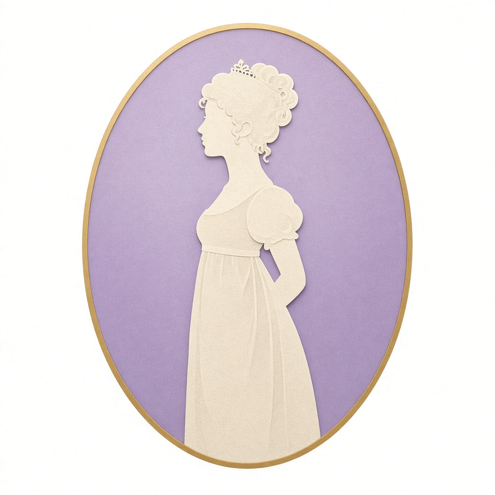

<!-- 波打つ見出し（動きます） -->

  

<!-- 一文字ずつ打たれていく紹介文（動きます） -->

  

<!-- バース、ロイヤル・クレセント（トマス・マルトン、1780年頃） -->

  
   
  バース、ロイヤル・クレセント（トマス・マルトン、1780年頃）

  
  

---

### 🌿 About

リージェンシー時代（1811–1820年ごろ）のイギリス文学と文化、とくにジェイン・オースティンの作品を研究しています。
風景描写やピクチャレスク美学を手がかりに、オースティンが見ていた世界を読み解き、デジタルで発信しています。

### 📖 Book

**『ジェイン・オースティンの手法について ―風景描写を中心に―』**
ブイツーソリューション（ISBN 978-4-434-04318-5）

- 第1章　時代背景（美意識の変遷、ピクチャレスク美学）
- 第2章　風景描写の手法（『高慢と偏見』『分別と多感』『ノーサンガー・アビィ』）
- 第3章　オースティンが観ていた現実性（『マンスフィールド・パーク』『エマ』『説得』）

 

### 🖼️ 図版

<table>
  <tr>
    <td align="center" valign="bottom" width="33%">
      
    </td>
    <td align="center" valign="bottom" width="34%">
      
    </td>
    <td align="center" valign="bottom" width="33%">
      
    </td>
  </tr>
  <tr>
    <td align="center">ウェルベック・アビー レプトン、1790年代</td>
    <td align="center">パンプ・ルーム ロウランドソン、1798年</td>
    <td align="center">王立協会の図書室 1809年</td>
  </tr>
  <tr>
    <td align="center" valign="bottom">
      
    </td>
    <td align="center" valign="bottom">
      
    </td>
    <td align="center" valign="bottom">
      
    </td>
  </tr>
  <tr>
    <td align="center">『高慢と偏見』初版扉 1813年</td>
    <td align="center">舞踏会の挿絵 トムソン、1894年</td>
    <td align="center">正装 アッカーマン、1810年</td>
  </tr>
</table>

出典・ライセンスは [画像クレジット](https://emmilia-sato.vercel.app/credits/) にまとめています。

### ✒️ Now

- 🏛️ 個人サイト [Jane Austen's Window](https://emmilia-sato.vercel.app/) を育てています
- 📝 [研究ノート](https://emmilia-sato.vercel.app/notes/) を少しずつ書いています
- 🎞️ 『高慢と偏見』の朗読劇やアニメ風の映像づくりにも挑戦中

### 🧵 Built with

  
  
  

  

<i>“I declare after all there is no enjoyment like reading!” — Pride and Prejudice</i>

  

